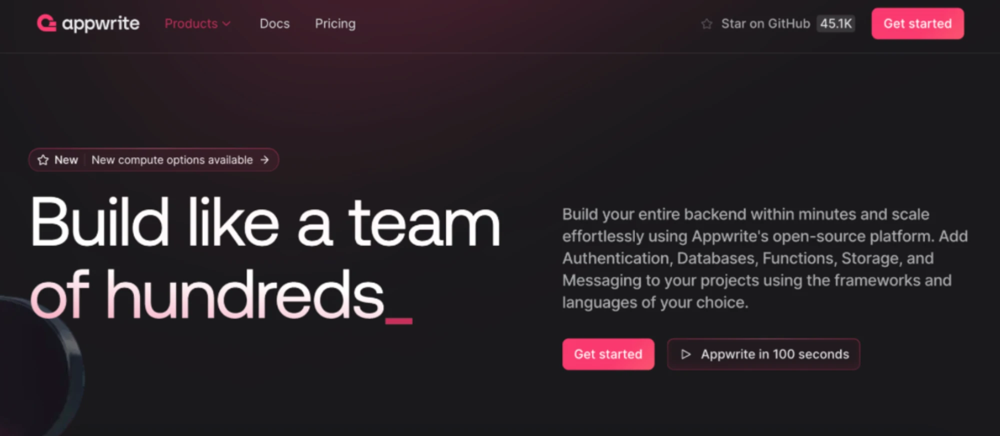

# Docker and Redesign Specification

**Approved**: 2026-10-31 - user: "Approve both, start"

## Problem Statement

Running SportScrapper takes two terminals and the right Node and pnpm versions, which makes the demo harder to install and use. The page also looks plain. This feature runs everything with one Docker command and gives the page a dark, crimson-accented design.

## Goals

- [ ] One `docker compose up --build` starts the whole app at `http://localhost:8080`, with Docker as the only prerequisite.
- [ ] The page takes on the look of the style reference, with its own content and no change to how headlines behave.

## Out of Scope

| Feature | Reason |
| ----------- | -------------- |
| Appwrite's logo, name, text or star counter | The image is a style reference for a different product |
| Refresh button | User chose real content only, with no Refresh |
| Light theme | The reference is dark only |
| Hot reload inside containers | User chose production-style Docker |
| Publishing images, HTTPS, deployment | The compose file is for local use |
| New scraping behaviour | The API stays exactly as it is |

---

## Assumptions & Open Questions

Every ambiguity is resolved or recorded here - nothing is left silently unclear.

| Assumption / decision | Chosen default | Rationale | Confirmed? |
| --------------------- | --------------- | --------- | ---------- |
| Status of the image | A style reference: look, not layout. Judged by eye in the review | User chose "Style reference" | y |
| Contents of the top of the page | Top bar, date pill, title, description and a `See headlines` button; nothing that doesn't work | User chose "Real content only" | y |
| Docker mode | Nginx serves the built frontend and passes `/api/` to the backend | User chose "Production-style" | y |
| Timezone in Docker | `TZ` from the environment, defaulting to `America/Sao_Paulo` | User chose "São Paulo, can be overridden" | y |
| Public port | 8080; free on this machine on 2026-10-31 | Port 5173 is taken here, and 8080 is the usual choice for this setup | n |
| Backend exposure | The backend is reachable only inside Docker | Only the frontend needs it | n |
| Without Docker | The two-terminal steps stay in the README under a separate heading | Developers still need them for tests and hot reload | n |
| Description text | `The last 7 days of CNN Sport, gathered in one place.` | States what the page does in one line | n |
| Date pill format | `Oct 24 – Oct 30, 2026`, and `Dec 27, 2026 – Jan 2, 2027` across a year end | Short enough for a pill on a phone | n |
| Cursor after the title | A static pink underscore, as the image draws it | Decorative, so it needs no animation | n |
| Palette | Background `#19191C`, cards `#232327`, text `#EDEDF0`, muted text `#ADADB0`, links `#FF6B93`, button `#D81B55` with white text | Appwrite's `#FD366E` with white text reaches only 3.5:1, so the button is darker and links lighter to pass 4.5:1 | n |
| Font | Inter, bundled through `@fontsource-variable/inter` | Close to the reference, and it needs no request to a font service | n |

**Dimensions sweep** - input validation: N/A because no new input exists. Failures: backend down is DOCK-01 AC 5. External dependency: an unset `TZ` is DOCK-01 AC 4. Remaining dimensions N/A for this scope.

**Open questions:** none - all resolved or logged above.

---

## User Stories

### P1: Run everything with one command ⭐ MVP

**User Story**: As anyone trying the demo, I want one Docker command so that I can run the app without installing Node or pnpm.

**Why P1**: This is the first thing the user asked for.

**Requirement**: DOCK-01

**Acceptance Criteria** (each line is one EARS pattern):

1. WHEN a person runs `docker compose up --build` in the repository root THEN the system SHALL start a backend and a frontend container and serve the page at `http://localhost:8080`.
2. WHEN the browser requests `/api/headlines` on port 8080 THEN the frontend container SHALL pass the request to the backend container and return its response.
3. The backend container SHALL NOT publish a port to the host.
4. WHERE `TZ` is set in the environment the backend container SHALL use that timezone, and IF `TZ` is unset THEN it SHALL use `America/Sao_Paulo`.
5. IF the backend container is stopped THEN the page SHALL show `Couldn't load headlines from CNN.`

**Independent Test**: In a fresh clone, run the command and open the address.

---

### P1: Install from the README with Docker ⭐ MVP

**User Story**: As a new developer, I want Docker to be the first way the README describes so that I can start quickly.

**Why P1**: Easier install and use is the reason for this work.

**Requirement**: DOCK-02

**Acceptance Criteria**:

1. The root `README.md` SHALL describe running with Docker before any other way, including the prerequisite, the command, the address, how to stop and how to change `TZ`.
2. The root `README.md` SHALL keep the steps for running without Docker under a separate heading.
3. WHEN the project structure changes THEN the README's project structure SHALL list the new files.

**Independent Test**: Follow only the README's Docker section in a fresh clone.

---

### P1: See the top of the page ⭐ MVP

**User Story**: As a reader, I want a striking header that tells me what this page is so that the demo makes a strong first impression.

**Why P1**: This is where the redesign shows most.

**Requirement**: PAGE-01

**Acceptance Criteria**:

1. The frontend SHALL show a top bar with the name `SportScrapper` and a `View on GitHub` link to `https://github.com/mcesarpl/sportScrapper` that opens in a new tab.
2. The frontend SHALL show the title `This Week's Sports Headlines` followed by a pink cursor hidden from screen readers.
3. The frontend SHALL show the description `The last 7 days of CNN Sport, gathered in one place.`
4. WHEN the response arrives THEN the frontend SHALL show a pill with the date range in the form `Oct 24 – Oct 30, 2026`.
5. WHEN the range crosses a year end THEN the pill SHALL read in the form `Dec 27, 2026 – Jan 2, 2027`.
6. WHILE the request is running the frontend SHALL show no pill.
7. IF the request fails THEN the frontend SHALL show no pill.
8. WHEN the reader uses `See headlines` THEN the page SHALL scroll to the headlines.

**Independent Test**: Open the page and use `See headlines`.

---

### P1: Give the page the new look ⭐ MVP

**User Story**: As a reader, I want the whole page to follow the dark crimson style so that it looks finished.

**Why P1**: The user asked for the redesign.

**Requirement**: PAGE-02

**Acceptance Criteria**:

1. The page SHALL use a dark charcoal background with a crimson glow at the top, in the style of `captures/style-reference.webp`.
2. The page SHALL keep every text and background pair at a contrast of at least 4.5:1.
3. The page SHALL keep showing each article's image, title, URL and publication date under its day heading.
4. The page SHALL show its loading, empty and error messages in the new style with their existing wording.
5. The page SHALL show all its content without horizontal page scrolling at window widths of 375px and 1280px.

**Independent Test**: Compare the running page with the style reference at both widths.

---

## Edge Cases

- WHEN `No image` is shown THEN it SHALL follow the new style, as covered by PAGE-02 AC 2.
- WHEN the backend is still starting THEN the page SHALL show the error message until the browser is reloaded, as covered by DOCK-01 AC 5.

---

## Requirement Traceability

| Requirement ID | Story | Phase | Status |
| -------------- | ----------- | ------ | ------- |
| PAGE-01 | P1: See the top of the page | Execute | Verified |
| PAGE-02 | P1: Give the page the new look | Execute | Verified |
| DOCK-01 | P1: Run everything with one command | Execute | Verified |
| DOCK-02 | P1: Install from the README with Docker | Execute | Verified |

**Coverage:** 4 total, 4 mapped to checks, 0 unmapped.

---

## Sources

- User message, 2026-10-31 - a Docker Compose file with frontend and backend, and a redesign following the image.
-  - non-binding - user: "Style reference"
- `.specs/features/weekly-headlines-with-images/spec.md` - the behaviours this redesign keeps.

---

## Success Criteria

- [ ] A person with only Docker installed reaches a working page with one command.
- [ ] The page reads as the same visual family as the style reference.
